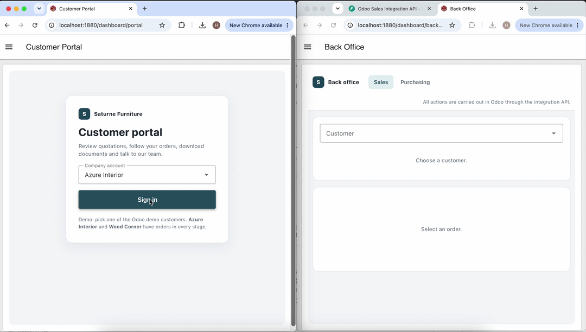
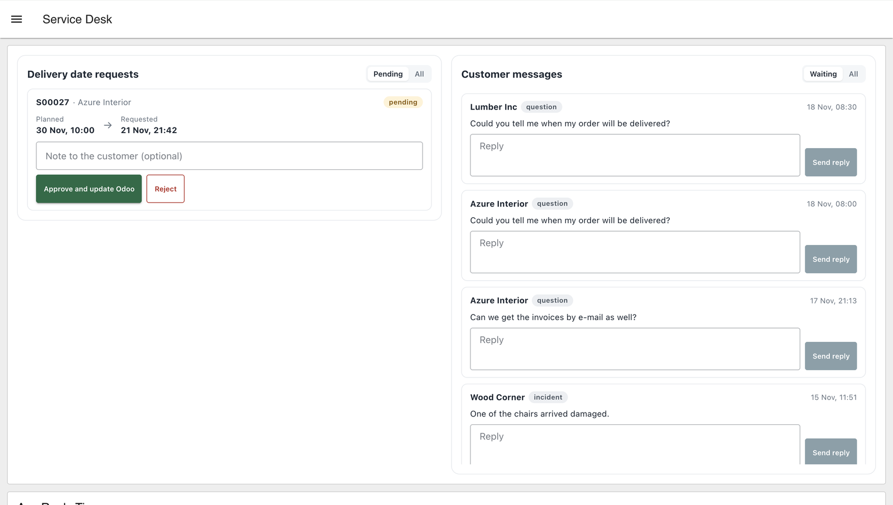
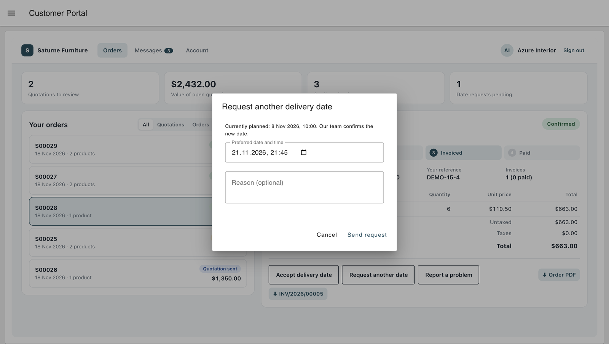
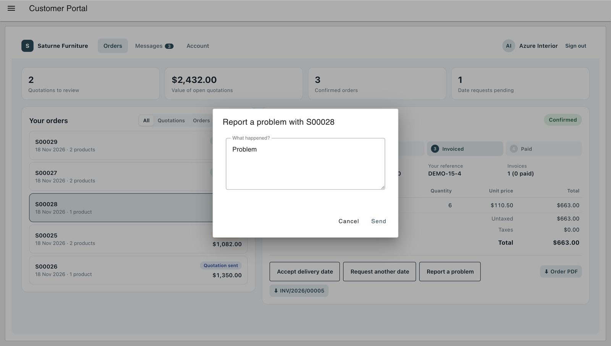
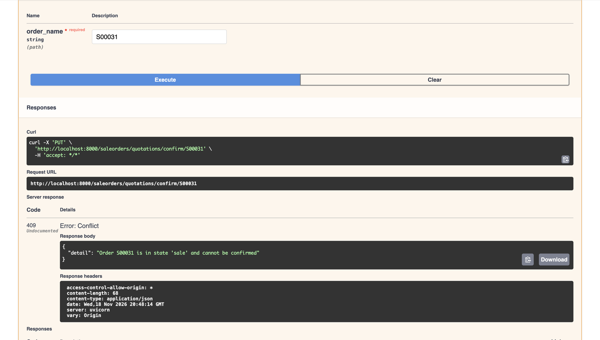
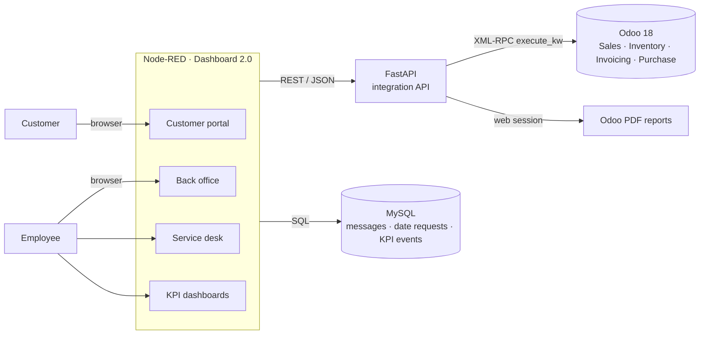
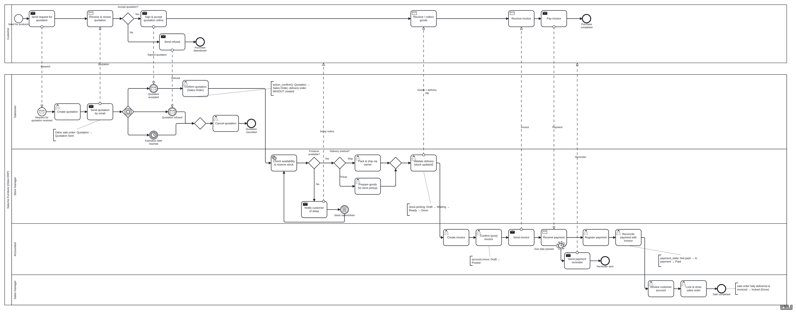

# Odoo Sales Integration

End-to-end integration of the **Odoo ERP sales process**: process modelling (BPMN / UML),
a **FastAPI** web service that exposes Odoo through its XML-RPC external API, and
**Node-RED** applications on top of it: a customer portal, an employee back office, a service
desk and KPI dashboards. Everything runs locally with one `docker compose` command.

[](https://github.com/embarky/odoo-sales-integration/actions/workflows/tests.yml)


[](LICENSE)



<sub>Left: customer portal. Right: employee back office. Every click is a call to the integration API, which carries it out in Odoo.</sub>

---

## What this project does

A company sells with Odoo, but its customers still use e-mail and phone to accept quotations,
ask about delivery dates and get invoices. This project opens the sales process to them:

1. **Analyse** the process as it runs in Odoo: BPMN collaboration diagram, UML class diagram
   and life cycles of the order, the delivery and the invoice.
2. **Integrate** Odoo behind a documented REST API (FastAPI over XML-RPC).
3. **Extend** it with Node-RED applications: a **customer portal** (review and change
   quotations, accept them, agree on delivery dates, report problems, download documents),
   a **back office** that runs order to cash and purchasing, a **service desk** that answers
   customers and approves their requests, and **KPI dashboards**.

The full write-up is in the [project report](docs/report/Odoo_Sales_Integration_Report.pdf).

## See it in action

<table>
<tr><td width="50%" valign="top"><b>Customer portal</b><br></td><td width="50%" valign="top"><b>Back office: quotation to payment</b><br></td></tr>
<tr><td width="50%" valign="top"><b>Service desk</b><br></td><td width="50%" valign="top"><b>KPI dashboard</b><br></td></tr>
</table>

**A customer asks for another delivery date, the service desk approves it, and the new date
is written to the order in Odoo:**


<details>
<summary>More screenshots</summary>

<table>
<tr><td width="50%" valign="top"><b>Sign in</b><br></td><td width="50%" valign="top"><b>A paid order</b><br></td></tr>
<tr><td width="50%" valign="top"><b>Delivery date request</b><br></td><td width="50%" valign="top"><b>Problem report</b><br></td></tr>
<tr><td width="50%" valign="top"><b>Messages and answers</b><br></td><td width="50%" valign="top"><b>Back office: purchasing</b><br></td></tr>
<tr><td width="50%" valign="top"><b>API: a refused action returns 409</b><br></td><td width="50%"></td></tr>
</table>

</details>

## Architecture



The API is the only component that talks to Odoo: credentials stay on the server and the
business rules are enforced in one place.

## Process model

The sales process is modelled as a BPMN 2.0 collaboration between the customer and four
company roles (salesman, store manager, accountant, sales manager), with the Odoo state reached
at each step. Sources: [as-is](docs/models/sales-process.bpmn) ·
[with the portal](docs/models/customer-portal-process.bpmn) (open in [bpmn.io](https://demo.bpmn.io)).



<details>
<summary>Extended process with the customer portal</summary>


</details>

## The API

29 endpoints for customers, sales orders, deliveries, invoices and purchase orders, documented
at `/docs` (Swagger UI).

- **One Odoo client** (`app/odoo.py`) handles authentication, timeouts and errors: Odoo's
  refusals become `409` with Odoo's message, missing records `404`, invalid input `422`.
- **Odoo's quirks are handled once:** methods that return `None`, wizards behind buttons
  (invoicing, payment, cancelling a sent quotation), PDF reports through a web session,
  UTC dates converted to local time.
- **Every action is checked:** the record is read back and an error is returned if Odoo did
  not reach the expected state.

<details>
<summary>Endpoints</summary>

| Area | Method | Endpoint | Odoo operation |
|---|---|---|---|
| Status | `GET` | `/get-status` | `common.version`, `authenticate` |
| Customers | `GET` | `/customers/all` · `/customers/companies` · `/customers/{id}` | `res.partner.search_read` |
| Sales orders | `GET` | `/saleorders/by_name/{name}` · `/saleorders/by_id/{customer_id}` · `/saleorders/by_orderid/{id}` | `sale.order` + `sale.order.line` |
| | `PUT` / `DELETE` | `/saleorders/{order}/lines/{line_id}` (quotations only) | `sale.order.line` `write` / `unlink` |
| | `PUT` | `/saleorders/quotations/confirm/{order}` | `action_confirm` |
| | `PUT` | `/saleorders/quotations/cancel/{order}` | `action_cancel` |
| | `POST` | `/saleorders/delivery/validate/{order}` | `stock.picking.button_validate` |
| | `POST` | `/saleorders/invoice/create/{order}` | wizard `sale.advance.payment.inv` |
| | `GET` | `/saleorders/delivery_date/query/{order}` | `commitment_date` / `expected_date` |
| | `PUT` | `/saleorders/delivery_date/confirm/{order}/accept` · `…/reject/{new_date}` | `write` + `message_post` |
| | `GET` | `/saleorders/get/pdf/{id}` | report `sale.report_saleorder` |
| Accounting | `GET` | `/accounting/invoice/by_saleorder/{order}` | `account.move.read` |
| | `POST` | `/accounting/invoice/{invoice_id}/confirm` · `…/pay` | `action_post` · wizard `account.payment.register` |
| | `GET` | `/accounting/invoice/get/pdf/{invoice_id}` | report `account.report_invoice_with_payments` |
| Vendors | `GET` | `/vendors/all` | `res.partner.search_read` |
| Purchase orders | `GET` | `/purchaseorders/by_vendor_id/{id}` · `/purchaseorders/by_id/{id}` | `purchase.order` + lines |
| | `PUT` | `/purchaseorders/confirm/{id}` · `/purchaseorders/cancel/{id}` | `button_confirm` · `button_cancel` |
| | `GET` / `PUT` | `/purchaseorders/deliverdate/query/{id}` · `…/confirm/{id}` | `date_planned` · `confirm_reminder_mail` |
| | `GET` | `/purchaseorders/get/pdf/{id}` | report `purchase.report_purchaseorder` |

</details>

## Run the demo yourself

Requirements: [Docker Desktop](https://www.docker.com/products/docker-desktop/) (or Docker
Engine with Compose), about 4 GB of free memory, and free ports 8069, 8000 and 1880.

```bash
git clone https://github.com/embarky/odoo-sales-integration.git
cd odoo-sales-integration
docker compose up -d --build
docker compose logs -f seed      # first start: 3–5 minutes, wait for "[seed] done"
```

### Open

| Application | Address | Who |
|---|---|---|
| Customer portal | <http://localhost:1880/dashboard/portal> | customers |
| Back office (sales and purchasing) | <http://localhost:1880/dashboard/back-office> | employees |
| Service desk and message KPIs | <http://localhost:1880/dashboard/service-desk> | employees |
| Portal KPIs | <http://localhost:1880/dashboard/kpi> | managers |
| API documentation | <http://localhost:8000/docs> | developers |
| Odoo (login `admin` / `admin`) | <http://localhost:8069> | to check the results in the ERP |
| Node-RED editor | <http://localhost:1880> | to look at the flows |

### Five-minute tour

1. **Portal:** sign in as **Azure Interior**, open a quotation, change a quantity and click
   **Accept and confirm**.
2. **Back office:** open the same order and click **Validate delivery → Create invoice →
   Confirm → Register payment**. The portal now shows it as *Paid*.
3. **Portal:** on a confirmed order (e.g. *S00028*) click **Request another date**;
   approve it in the **service desk** and the new date is written to Odoo.

Use the demo customers Azure Interior and Wood Corner: some of Odoo's own sample orders
predate the Inventory app and cannot be invoiced.

```bash
docker compose stop              # stop, keep the data
docker compose down -v           # remove everything; the next start gives a fresh demo
```

<details>
<summary>Troubleshooting, own Odoo, running the API without Docker</summary>

- **Port already allocated:** change the left-hand port in `docker-compose.yml` (e.g. `"8070:8069"`).
- **The portal shows no customers:** Odoo is still being prepared; wait for `[seed] done`.
- **Own Odoo 17/18:** copy `.env.example` to `.env`, set the variables below and restart.
- **API without Docker:**

  ```bash
  cd api && python -m venv .venv && source .venv/bin/activate
  pip install -r requirements-dev.txt && cp ../.env.example .env   # then edit .env
  uvicorn app.main:app --reload
  ```

| Variable | Description | Default |
|---|---|---|
| `ODOO_URL` | Odoo instance, e.g. `https://mycompany.odoo.com` | required |
| `ODOO_DB` | Database name | required |
| `ODOO_USER` / `ODOO_PASSWORD` | API user login and password (or API key) | required |
| `ODOO_VERIFY_SSL` | Verify the TLS certificate | `true` |
| `ODOO_TIMEOUT` | Timeout of a call to Odoo, in seconds | `30` |
| `APP_TIMEZONE` | Time zone used for dates shown and entered by users | `Europe/Zurich` |
| `CORS_ORIGINS` | Comma-separated origins allowed to call the API | `*` |

</details>

## Tests

`cd api && pytest` runs 38 tests against an in-memory fake Odoo XML-RPC server; they run on
every push with GitHub Actions, together with a lint check and a check of the Docker and
Node-RED configuration.

## Repository layout

```
api/            FastAPI application and tests
node-red/       flows of the portal, back office, service desk and KPI dashboards
database/       MySQL schema and demo data
demo/           script that prepares the Odoo demo database
docs/           BPMN models, project report, screenshots
```

## Limitations

This is a demonstration system. Real use would need authentication for customers,
employees and the API; Odoo record rules instead of one technical user; partial
deliveries and payments; and secrets kept out of `node-red/flows_cred.json`.

## Team

v1.0 was a group project for the course *Enterprise Data and Integration* at HEC Lausanne,
University of Lausanne (2025), by Hang Yang, Yi Huang and Kyle Fletcher: Hang Yang wrote the
code (the `v1.0` tag, a single API script) and the team did the process analysis and the first
report. v2.0 – the restructured API, the portal, back office and service desk, the demo
environment and the revised report – is by Hang Yang, developed with Claude (Anthropic) as a
coding assistant; all changes were designed, reviewed and tested by Hang Yang.

## License

Released under the [MIT License](LICENSE) © 2025–2026 Hang Yang.
