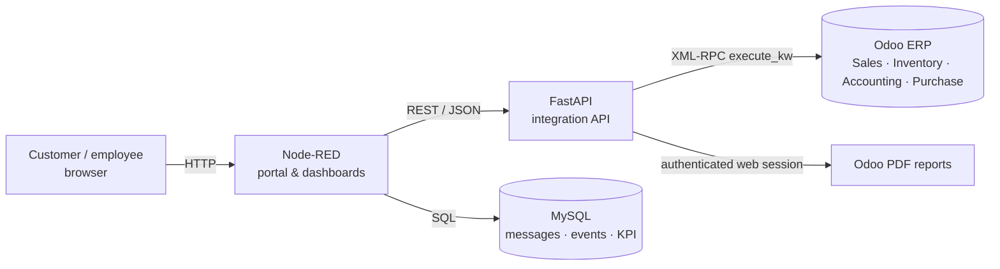

# Odoo Sales Integration

End-to-end integration of the **Odoo ERP sales process**: process modelling (BPMN / UML),
a **FastAPI** web service that exposes Odoo through its XML-RPC external API, and a
**Node-RED** customer portal with KPI dashboards.

> Group project for the course *Enterprise Data and Integration* at HEC Lausanne (University of Lausanne), autumn semester 2025 — group **Saturne**.


---

## What this project does

A company sells products with Odoo. Its customers still go through e-mail and phone for
everything: accepting a quotation, asking about a delivery date, getting an invoice.
This project opens the sales process to external applications in three steps.

1. **Analyse** the sales process as it runs in Odoo, from the request for quotation to
   payment and reconciliation: BPMN collaboration diagram, UML class diagram and state
   diagrams of the main business objects.
2. **Integrate**: a REST API that hides Odoo's XML-RPC interface behind clean, documented
   endpoints for customers, sales orders, invoices, deliveries and purchase orders.
3. **Extend**: a Node-RED customer portal on top of the API (view orders, confirm or cancel
   quotations, accept or reschedule delivery dates, download invoices, send messages),
   plus KPI dashboards that measure how the portal is used.

## Architecture



The API is the single entry point to Odoo: the portal never talks to the ERP directly, so
credentials stay on the server and business rules (which order can be confirmed, which
date format is accepted, …) are enforced in one place.

## Process model

The sales process is modelled as a BPMN 2.0 collaboration between the **customer** and the
company, whose lanes are the four roles involved: salesman, store manager, accountant and
sales manager.


Highlights of the model:

- **Waiting for the customer.** An event-based gateway waits for whichever comes first:
  acceptance, refusal, or expiry of the quotation (timer).
- **Out of stock.** The customer is notified of the delay and the process resumes when the
  stock is replenished.
- **Two delivery channels:** shipping via a carrier, or pickup at the store.
- **Invoicing on delivered quantities**, which matches the API (`advance_payment_method = "delivered"`).
- **Payment reminders.** A non-interrupting timer sends a reminder when payment is overdue.
- **Odoo states** are annotated on the diagram at each step (quotation → sales order,
  delivery ready → done, invoice draft → posted → paid).

The editable source is [`docs/models/sales-process.bpmn`](docs/models/sales-process.bpmn).
It opens in [bpmn.io](https://demo.bpmn.io) or Camunda Modeler.

## The API

Built with FastAPI. Interactive documentation is served at `/docs` (Swagger UI).

| Area | Method | Endpoint | Odoo operation |
|---|---|---|---|
| Status | `GET` | `/get-status` | `common.version`, `authenticate` |
| Customers | `GET` | `/customers/all` · `/customers/companies` · `/customers/{id}` | `res.partner.search_read` |
| Sales orders | `GET` | `/saleorders/by_name/{name}` · `/saleorders/by_id/{customer_id}` · `/saleorders/by_orderid/{id}` | `sale.order` + `sale.order.line` |
| | `PUT` | `/saleorders/quotations/confirm/{order}` | `action_confirm` |
| | `PUT` | `/saleorders/quotations/cancel/{order}` | `action_cancel` |
| | `POST` | `/saleorders/invoice/create/{order}` | wizard `sale.advance.payment.inv` |
| | `GET` | `/saleorders/delivery_date/query/{order}` | `commitment_date` / `expected_date` |
| | `PUT` | `/saleorders/delivery_date/confirm/{order}/accept` · `…/reject/{new_date}` | `write` + `message_post` |
| | `GET` | `/saleorders/get/pdf/{id}` | report `sale.report_saleorder` |
| Accounting | `GET` | `/accounting/invoice/by_saleorder/{order}` | `account.move.read` |
| | `GET` | `/accounting/invoice/get/pdf/{invoice_id}` | report `account.report_invoice_with_payments` |
| Vendors | `GET` | `/vendors/all` | `res.partner.search_read` |
| Purchase orders | `GET` | `/purchaseorders/by_vendor_id/{id}` · `/purchaseorders/by_id/{id}` | `purchase.order` + lines |
| | `PUT` | `/purchaseorders/confirm/{id}` · `/purchaseorders/cancel/{id}` | `button_confirm` · `button_cancel` |
| | `GET` / `PUT` | `/purchaseorders/deliverdate/query/{id}` · `…/confirm/{id}` | `date_planned` · `confirm_reminder_mail` |
| | `GET` | `/purchaseorders/get/pdf/{id}` | report `purchase.report_purchaseorder` |

### Design choices

- **One Odoo client.** All Odoo calls go through `app/odoo.py`, which handles
  authentication, timeouts, and translation of Odoo faults into HTTP errors: `404` not found,
  `409` refused by Odoo (e.g. "nothing to invoice"), `422` invalid input, `502`/`503` when
  Odoo itself has a problem.
- **Odoo quirks handled in one place.**
  - Methods that return `None` cannot be serialised by XML-RPC, even though they succeed.
  - Cancelling a sent quotation needs `disable_cancel_warning`, otherwise Odoo returns a
    confirmation wizard instead of cancelling.
  - `action_invoice_create` no longer exists; invoices are created through the same wizard
    as the *Create Invoice* button.
  - PDF reports are not available over XML-RPC, so they are downloaded through an
    authenticated web session.
- **State checks after every action.** The API reads the record back and reports an error
  if Odoo did not reach the expected state, instead of assuming success.
- **Time zones.** Odoo stores datetimes in naive UTC. The API converts them to and from
  local time (`Europe/Zurich` by default) so users always see and enter local dates.
- **No secrets in code.** All configuration comes from environment variables (`.env`).

## Repository layout

```
odoo-sales-integration/
├── api/
│   ├── app/
│   │   ├── main.py            # FastAPI app, CORS, error handler
│   │   ├── config.py          # settings from environment variables
│   │   ├── odoo.py            # XML-RPC client, error mapping, PDF reports
│   │   ├── timeutils.py       # UTC <-> local time
│   │   ├── dependencies.py    # shared FastAPI dependencies and helpers
│   │   └── routers/           # one module per business area
│   ├── tests/                 # pytest suite with a fake Odoo XML-RPC server
│   ├── Dockerfile
│   └── requirements*.txt
├── node-red/                  # Node-RED flows (portal, KPIs, employee dashboard) and image
├── docs/
│   └── models/                # BPMN process model (source and image)
├── database/                  # MySQL schema and demo data for the portal and KPIs
├── demo/                      # script that prepares the Odoo demo database
├── docker-compose.yml         # complete demo environment
└── .env.example
```

## Getting started

### Demo environment (Docker)

One command starts the whole system with demo data: Odoo 18 Community, the API, the
Node-RED portal and dashboards, and the MySQL database.

```bash
git clone https://github.com/embarky/odoo-sales-integration.git
cd odoo-sales-integration
docker compose up -d --build
```

The first start takes a few minutes: Odoo creates its database and installs Sales,
Inventory, Invoicing and Purchase, then a one-off job adds demo orders in every stage of the
process (quotation, sent, confirmed, invoiced, paid).

| Service | URL |
|---|---|
| Customer portal and KPI dashboards | <http://localhost:1880/dashboard> |
| Employee dashboard (sales and purchase) | <http://localhost:1880/ui> |
| API documentation (Swagger UI) | <http://localhost:8000/docs> |
| Odoo (login `admin` / `admin`) | <http://localhost:8069> |
| Node-RED editor | <http://localhost:1880> |

All passwords in the demo environment are local defaults. To connect the API to another
Odoo instance, copy `.env.example` to `.env` and fill in its URL, database and login.

### Without Docker

```bash
cd api
python -m venv .venv && source .venv/bin/activate    # Windows: .venv\Scripts\activate
pip install -r requirements-dev.txt
cp ../.env.example .env                               # then edit it
uvicorn app.main:app --reload
```

### Configuration

| Variable | Description | Default |
|---|---|---|
| `ODOO_URL` | Odoo instance, e.g. `https://mycompany.odoo.com` | required |
| `ODOO_DB` | Database name | required |
| `ODOO_USER` / `ODOO_PASSWORD` | API user login and password (or API key) | required |
| `ODOO_VERIFY_SSL` | Verify the TLS certificate | `true` |
| `ODOO_TIMEOUT` | Timeout of a call to Odoo, in seconds | `30` |
| `APP_TIMEZONE` | Time zone used for dates shown and entered by users | `Europe/Zurich` |
| `CORS_ORIGINS` | Comma-separated origins allowed to call the API | `*` |

## Tests

```bash
cd api
pytest
```

The suite starts an in-memory **fake Odoo XML-RPC server**, so the tests run without
network access or an Odoo account. It still goes through the real XML-RPC transport, and
the fake server reproduces the Odoo behaviours the API depends on: fault codes, missing
records, methods returning `None`, the cancel wizard, and validation errors.

## Team

Group Saturne: Hang Yang, Yi Huang, Kyle Fletcher.

## License

Released for portfolio and educational purposes. Odoo is a trademark of Odoo S.A.; this
project is not affiliated with Odoo S.A.
