# Odoo Sales Integration

End-to-end integration of the **Odoo ERP sales process**: process modelling (BPMN / UML),
a **FastAPI** web service that exposes Odoo through its XML-RPC external API, and
**Node-RED** applications on top of it: a customer portal, an employee back office, a service
desk and KPI dashboards. Everything runs locally with one `docker compose` command.

[](https://github.com/embarky/odoo-sales-integration/actions/workflows/tests.yml)


[](LICENSE)


<sub>Left: customer portal. Right: employee back office. Every click is a call to the integration API, which carries it out in Odoo.</sub>

---

## What this project does

A company sells products with Odoo. Its customers still go through e-mail and phone for
everything: accepting a quotation, asking about a delivery date, getting an invoice.
This project opens the sales process to external applications in three steps.

1. **Analyse** the sales process as it runs in Odoo, from the request for quotation to
   payment and reconciliation: BPMN collaboration diagram, UML class diagram and state
   diagrams of the main business objects.
2. **Integrate**: a REST API that hides Odoo's XML-RPC interface behind clean, documented
   endpoints for customers, sales orders, invoices, deliveries and purchase orders.
3. **Extend**: a Node-RED customer portal on top of the API (review and edit quotations,
   accept or decline them, follow orders through invoicing and payment, download documents,
   request a new delivery date, report a problem, talk to the service team), an employee
   back office that runs the whole order-to-cash process (confirm, deliver, invoice, register
   payment) and the purchasing steps, a service desk where employees answer and approve
   customer requests, and KPI dashboards that measure how the portal is used.

## See it in action

| Customer portal: review and change a quotation | Back office: from quotation to payment |
|---|---|
| 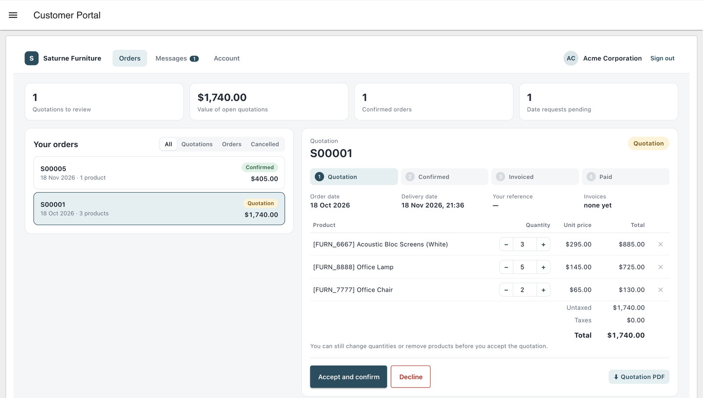 | 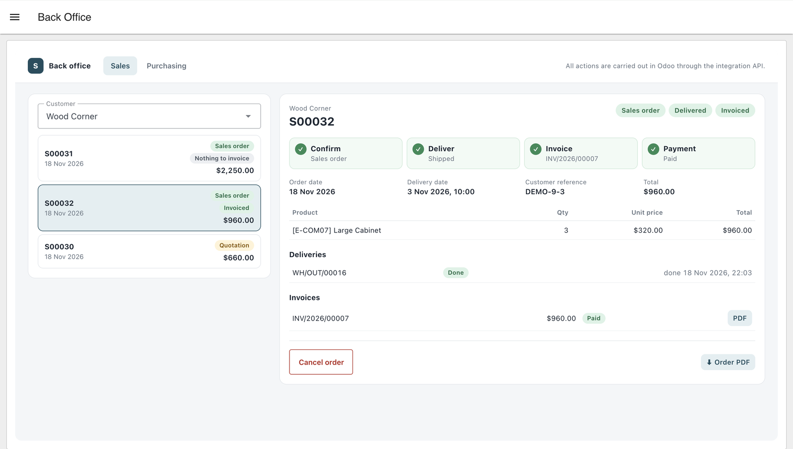 |
| **Service desk: answer customers, approve requests** | **KPI dashboard** |
|  | 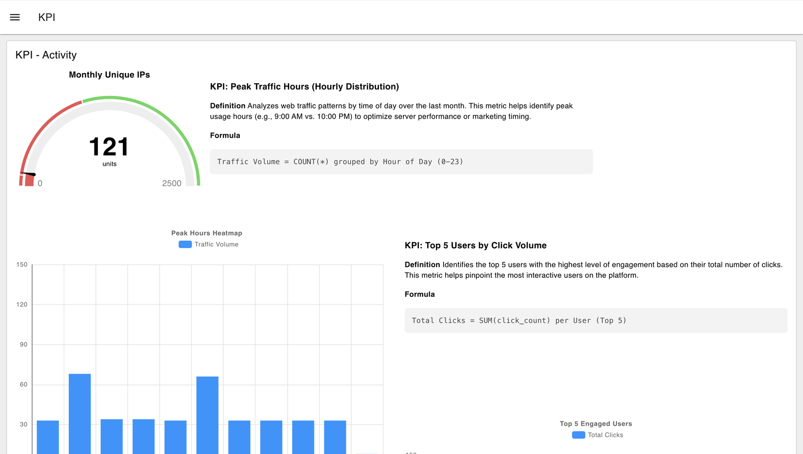 |

**A customer asks for another delivery date, the service desk approves it, and the new date
is written to the order in Odoo:**

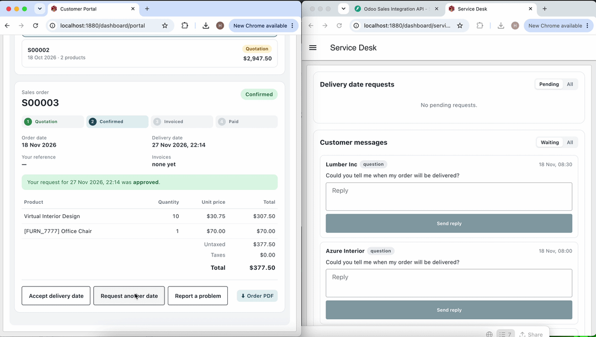

<details>
<summary>More screenshots</summary>

| | |
|---|---|
| 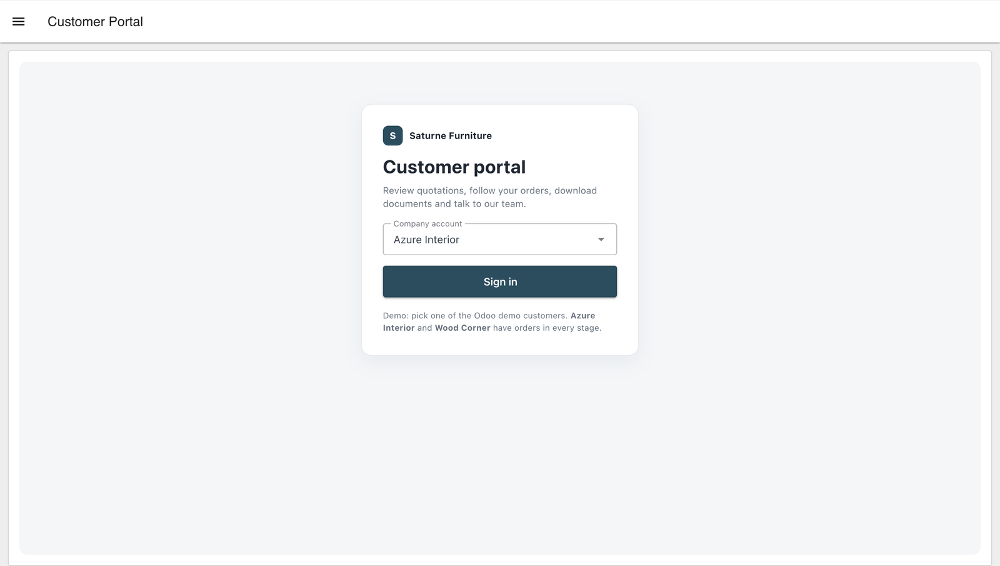 | 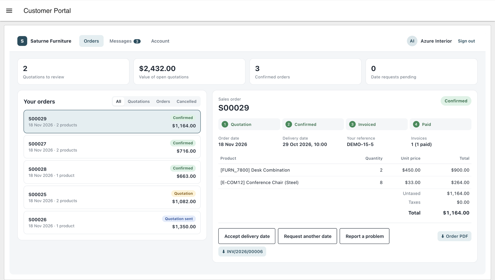 |
| Sign in (demo: choose a customer account) | A paid order: progress, documents |
|  |  |
| Request another delivery date | Report a problem with an order |
| 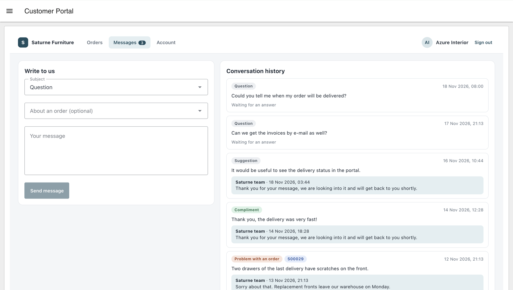 | 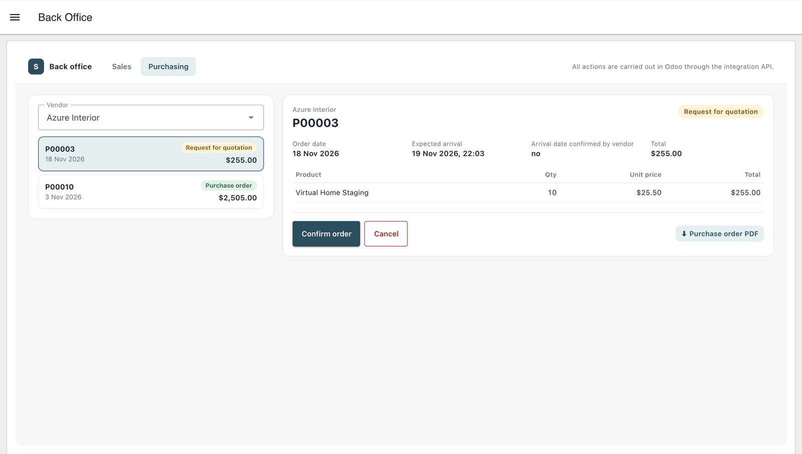 |
| Messages and answers from the service team | Back office: purchasing |
|  | |
| API documentation: a refused action returns HTTP 409 with Odoo's reason | |

</details>

## Architecture

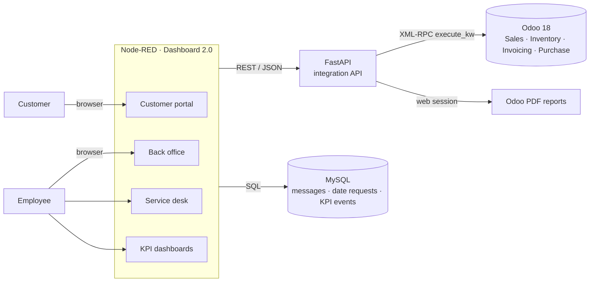

The API is the single entry point to Odoo: the portal never talks to the ERP directly, so
credentials stay on the server and business rules (which order can be confirmed, which
date format is accepted, …) are enforced in one place.

## Process model

The sales process is modelled as a BPMN 2.0 collaboration between the **customer** and the
company, whose lanes are the four roles involved: salesman, store manager, accountant and
sales manager.


Highlights of the model:

- **Waiting for the customer.** An event-based gateway waits for whichever comes first:
  acceptance, refusal, or expiry of the quotation (timer).
- **Out of stock.** The customer is notified of the delay and the process resumes when the
  stock is replenished.
- **Two delivery channels:** shipping via a carrier, or pickup at the store.
- **Invoicing on delivered quantities**, which matches the API (`advance_payment_method = "delivered"`).
- **Payment reminders.** A non-interrupting timer sends a reminder when payment is overdue.
- **Odoo states** are annotated on the diagram at each step (quotation → sales order,
  delivery ready → done, invoice draft → posted → paid).

The editable source is [`docs/models/sales-process.bpmn`](docs/models/sales-process.bpmn).
It opens in [bpmn.io](https://demo.bpmn.io) or Camunda Modeler.

**Extended process with the customer portal.** Customers review and change quotations,
accept them, accept or request delivery dates and report problems in the portal; the portal
carries these actions out in Odoo through the API, and the service desk decides on requests
that commit the company. Source: [`docs/models/customer-portal-process.bpmn`](docs/models/customer-portal-process.bpmn).

<details>
<summary>BPMN diagram of the extended process</summary>

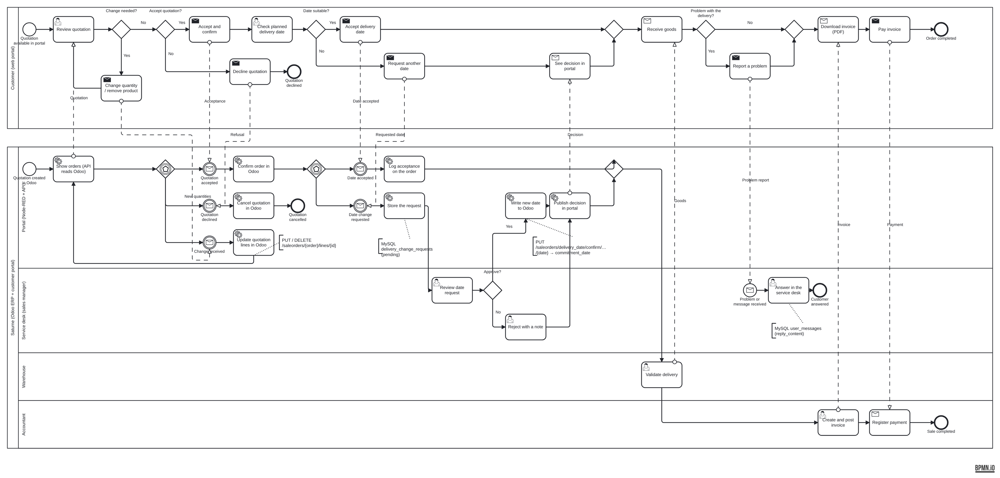

</details>

## The API

Built with FastAPI. Interactive documentation is served at `/docs` (Swagger UI).

<details>
<summary>Screenshot of the API documentation</summary>

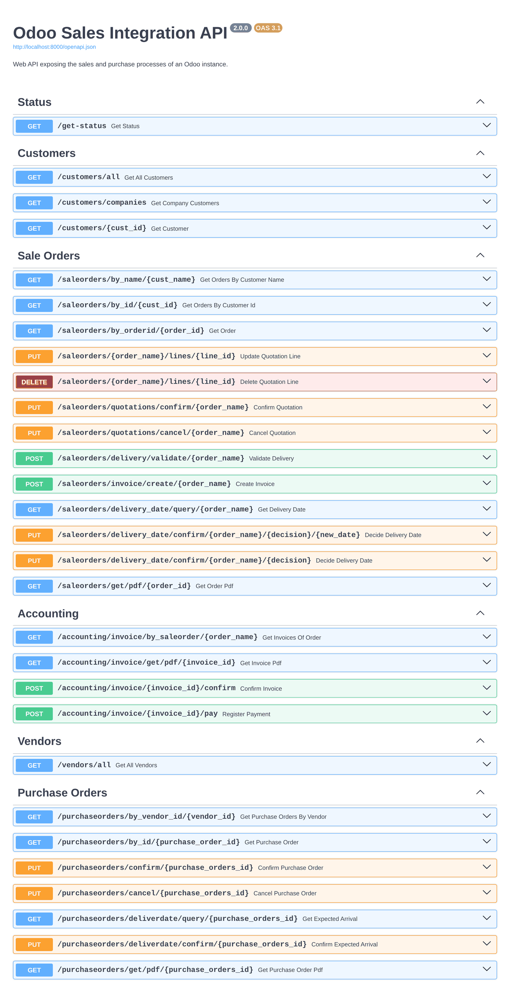

</details>

| Area | Method | Endpoint | Odoo operation |
|---|---|---|---|
| Status | `GET` | `/get-status` | `common.version`, `authenticate` |
| Customers | `GET` | `/customers/all` · `/customers/companies` · `/customers/{id}` | `res.partner.search_read` |
| Sales orders | `GET` | `/saleorders/by_name/{name}` · `/saleorders/by_id/{customer_id}` · `/saleorders/by_orderid/{id}` | `sale.order` + `sale.order.line` |
| | `PUT` / `DELETE` | `/saleorders/{order}/lines/{line_id}` (quotations only) | `sale.order.line` `write` / `unlink` |
| | `PUT` | `/saleorders/quotations/confirm/{order}` | `action_confirm` |
| | `PUT` | `/saleorders/quotations/cancel/{order}` | `action_cancel` |
| | `POST` | `/saleorders/delivery/validate/{order}` | `stock.picking.button_validate` |
| | `POST` | `/saleorders/invoice/create/{order}` | wizard `sale.advance.payment.inv` |
| | `GET` | `/saleorders/delivery_date/query/{order}` | `commitment_date` / `expected_date` |
| | `PUT` | `/saleorders/delivery_date/confirm/{order}/accept` · `…/reject/{new_date}` | `write` + `message_post` |
| | `GET` | `/saleorders/get/pdf/{id}` | report `sale.report_saleorder` |
| Accounting | `GET` | `/accounting/invoice/by_saleorder/{order}` | `account.move.read` |
| | `POST` | `/accounting/invoice/{invoice_id}/confirm` · `…/pay` | `action_post` · wizard `account.payment.register` |
| | `GET` | `/accounting/invoice/get/pdf/{invoice_id}` | report `account.report_invoice_with_payments` |
| Vendors | `GET` | `/vendors/all` | `res.partner.search_read` |
| Purchase orders | `GET` | `/purchaseorders/by_vendor_id/{id}` · `/purchaseorders/by_id/{id}` | `purchase.order` + lines |
| | `PUT` | `/purchaseorders/confirm/{id}` · `/purchaseorders/cancel/{id}` | `button_confirm` · `button_cancel` |
| | `GET` / `PUT` | `/purchaseorders/deliverdate/query/{id}` · `…/confirm/{id}` | `date_planned` · `confirm_reminder_mail` |
| | `GET` | `/purchaseorders/get/pdf/{id}` | report `purchase.report_purchaseorder` |

### Design choices

- **One Odoo client.** All Odoo calls go through `app/odoo.py`, which handles
  authentication, timeouts, and translation of Odoo faults into HTTP errors: `404` not found,
  `409` refused by Odoo (e.g. "nothing to invoice"), `422` invalid input, `502`/`503` when
  Odoo itself has a problem.
- **Odoo quirks handled in one place.**
  - Methods that return `None` cannot be serialised by XML-RPC, even though they succeed.
  - Cancelling a sent quotation needs `disable_cancel_warning`, otherwise Odoo returns a
    confirmation wizard instead of cancelling.
  - `action_invoice_create` no longer exists; invoices are created through the same wizard
    as the *Create Invoice* button.
  - PDF reports are not available over XML-RPC, so they are downloaded through an
    authenticated web session.
- **State checks after every action.** The API reads the record back and reports an error
  if Odoo did not reach the expected state, instead of assuming success.
- **Time zones.** Odoo stores datetimes in naive UTC. The API converts them to and from
  local time (`Europe/Zurich` by default) so users always see and enter local dates.
- **No secrets in code.** All configuration comes from environment variables (`.env`).

## Repository layout

```
odoo-sales-integration/
├── api/
│   ├── app/
│   │   ├── main.py            # FastAPI app, CORS, error handler
│   │   ├── config.py          # settings from environment variables
│   │   ├── odoo.py            # XML-RPC client, error mapping, PDF reports
│   │   ├── timeutils.py       # UTC <-> local time
│   │   ├── dependencies.py    # shared FastAPI dependencies and helpers
│   │   └── routers/           # one module per business area
│   ├── tests/                 # pytest suite with a fake Odoo XML-RPC server
│   ├── Dockerfile
│   └── requirements*.txt
├── node-red/                  # Node-RED flows (portal, back office, service desk, KPIs) and image
├── docs/
│   ├── models/                # BPMN process models, as-is and with the portal (source and image)
│   ├── report/                # project report (PDF and Word)
│   └── screenshots/           # screenshots and demo recordings used in this README
├── database/                  # MySQL schema and demo data for the portal and KPIs
├── demo/                      # script that prepares the Odoo demo database
├── .github/workflows/         # continuous integration (tests)
├── docker-compose.yml         # complete demo environment
├── LICENSE                    # MIT
└── .env.example
```

## Run the demo yourself

The repository contains everything needed to run the whole system on your own computer:
Odoo 18 Community with demo data, the API, the Node-RED applications and MySQL.
Nothing is shared with other users and nothing needs an account.

### 1. Requirements

- [Docker Desktop](https://www.docker.com/products/docker-desktop/) (macOS, Windows) or Docker
  Engine with the Compose plugin (Linux)
- about 4 GB of free memory and 3 GB of disk space
- free ports **8069** (Odoo), **8000** (API) and **1880** (Node-RED)

### 2. Start

```bash
git clone https://github.com/embarky/odoo-sales-integration.git
cd odoo-sales-integration
docker compose up -d --build
```

The first start takes 3–5 minutes: Odoo creates its database and installs Sales, Inventory,
Invoicing and Purchase, then a one-off job adds demo orders in every stage of the process.
To follow it:

```bash
docker compose logs -f seed      # wait for "[seed] done", then press Ctrl+C
```

### 3. Open

| Application | Address | Who |
|---|---|---|
| Customer portal | <http://localhost:1880/dashboard/portal> | customers |
| Back office (sales and purchasing) | <http://localhost:1880/dashboard/back-office> | employees |
| Service desk and message KPIs | <http://localhost:1880/dashboard/service-desk> | employees |
| Portal KPIs | <http://localhost:1880/dashboard/kpi> | managers |
| API documentation | <http://localhost:8000/docs> | developers |
| Odoo (login `admin` / `admin`) | <http://localhost:8069> | to check the results in the ERP |
| Node-RED editor | <http://localhost:1880> | to look at the flows |

### 4. A five-minute tour

1. **Portal:** sign in as **Azure Interior**. Open a *Quotation*, change a quantity and click
   **Accept and confirm**.
2. **Back office:** choose *Azure Interior*, open the same order and click through
   **Validate delivery → Create invoice → Confirm → Register payment**.
3. **Portal:** open the order again: it is now *Paid* and the invoice can be downloaded.
4. **Portal:** open a confirmed order without a pending request (e.g. *S00028*) and click
   **Request another date**.
   **Service desk:** approve the request. Odoo now has the new delivery date (see the
   order's chatter in Odoo).
5. **Portal → Messages:** send a message; answer it in the **service desk**.

Use the demo customers **Azure Interior** and **Wood Corner**: their orders were created by the
demo script and go through every step. Some of Odoo's own sample orders were created before
the Inventory app was installed, so Odoo does not record their deliveries and refuses to
invoice them.

### 5. Stop, reset, remove

```bash
docker compose stop              # stop, keep the data
docker compose up -d             # start again
docker compose down -v           # remove everything, including the data (fresh demo on next start)
```

### Troubleshooting

| Problem | Solution |
|---|---|
| `port is already allocated` | Another program uses 8069, 8000 or 1880. Stop it, or change the left-hand port in `docker-compose.yml` (e.g. `"8070:8069"`). |
| The portal shows no customers | Odoo is still being prepared. Wait for `[seed] done` (step 2) and reload the page. |
| Something is in a strange state after many tests | `docker compose down -v && docker compose up -d --build` gives a fresh demo. |
| Docker runs out of memory | Give Docker Desktop at least 4 GB (Settings → Resources). |

### Use your own Odoo

The API can work with any Odoo 17/18 database that has Sales, Inventory and Invoicing: copy
`.env.example` to `.env`, fill in `ODOO_URL`, `ODOO_DB`, `ODOO_USER` and `ODOO_PASSWORD`
(an API key works as password), and start the stack again. All passwords in the demo
environment are local defaults.

### Run the API without Docker

```bash
cd api
python -m venv .venv && source .venv/bin/activate    # Windows: .venv\Scripts\activate
pip install -r requirements-dev.txt
cp ../.env.example .env                               # then edit it
uvicorn app.main:app --reload
```

### Configuration

| Variable | Description | Default |
|---|---|---|
| `ODOO_URL` | Odoo instance, e.g. `https://mycompany.odoo.com` | required |
| `ODOO_DB` | Database name | required |
| `ODOO_USER` / `ODOO_PASSWORD` | API user login and password (or API key) | required |
| `ODOO_VERIFY_SSL` | Verify the TLS certificate | `true` |
| `ODOO_TIMEOUT` | Timeout of a call to Odoo, in seconds | `30` |
| `APP_TIMEZONE` | Time zone used for dates shown and entered by users | `Europe/Zurich` |
| `CORS_ORIGINS` | Comma-separated origins allowed to call the API | `*` |

## Tests

```bash
cd api
pytest
```

38 tests run on every push with GitHub Actions. The suite starts an in-memory **fake Odoo XML-RPC server**, so the tests run without
network access or an Odoo account. It still goes through the real XML-RPC transport, and
the fake server reproduces the Odoo behaviours the API depends on: fault codes, missing
records, methods returning `None`, the cancel wizard, and validation errors.

## Limitations and production readiness

This is a demonstration system. Before real use it would need:

- **Authentication.** Portal users sign in by choosing a company; the API itself has no
  authentication. A real deployment would use Odoo portal accounts (or an identity provider)
  for customers and employees, and protect the API with keys or tokens.
- **Per-user access rights.** The API calls Odoo with one technical user. The portal only
  lists the signed-in customer's orders, but the API does not check who is asking; Odoo's
  record rules for portal users would enforce this in production.
- **Fuller business cases.** Deliveries are validated for the full ordered quantity
  (no partial deliveries or backorders) and payments are registered in full with the default
  journal; one currency and one time zone (`Europe/Zurich`) are assumed.
- **Secrets.** The demo database password is stored in `node-red/flows_cred.json` so that the
  demo runs without setup; real credentials belong in environment variables or a secret store.
- **Operations.** Logging, monitoring and backups of the Odoo and MySQL databases.

## Team

v1.0 was built as a group project for the course *Enterprise Data and Integration* at
HEC Lausanne, University of Lausanne (2025), by Hang Yang, Yi Huang and Kyle Fletcher.
Hang Yang wrote the code; the process analysis and the first version of the report were
written by the team. The post-course work in v2.0 – the restructured and tested API, the new
portal, back office and service desk, the Docker demo environment and the revised report – is
by Hang Yang.

The full project report – process analysis, API design, extended process, data classes,
user interface, KPIs and tests – is in [`docs/report`](docs/report)
([PDF](docs/report/Odoo_Sales_Integration_Report.pdf) · [Word](docs/report/Odoo_Sales_Integration_Report.docx)).

### Use of AI tools

In v2.0, Claude (Anthropic), an AI assistant, was used to refactor and complete the project:
restructuring and testing the API, redesigning the portal and adding the back office and service
desk, building the Docker demo environment, and revising the documentation and the report.
Hang Yang defined the scope, made the design decisions, validated the system end to end and
reviewed all changes.

## License

Released under the [MIT License](LICENSE) © 2025–2026 Hang Yang: free to use, copy, modify
and distribute, including for commercial purposes, as long as the copyright notice is kept.
Odoo is a trademark of Odoo S.A.; this project is not affiliated with Odoo S.A.
